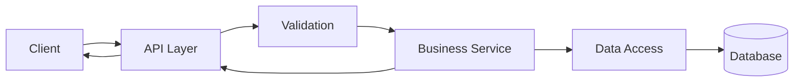

# Kiến trúc hệ thống

## Nguyên tắc

- Tách lớp giao tiếp, nghiệp vụ và truy cập dữ liệu.
- Nghiệp vụ không phụ thuộc trực tiếp vào chi tiết HTTP hoặc lưu trữ.
- Kiểm tra đầu vào tại biên hệ thống; bảo vệ bất biến nghiệp vụ trong lớp nghiệp vụ.
- Chỉ thêm abstraction khi có nhu cầu thực tế và được kiểm thử.

## Luồng xử lý chuẩn

## Ranh giới trách nhiệm

| Thành phần | Trách nhiệm |
|---|---|
| API Layer | Spring MVC controller, nhận request, xác thực đầu vào, ánh xạ response; cấu hình CORS qua `CorsConfigurationSource` từ `app.cors.allowed-origins` hỗ trợ đa origin, credentials, cấm wildcard `*` |
| Business Service | Thực thi quy tắc nghiệp vụ và giao dịch; tối ưu danh sách task bằng batch query cho tags, checklist, comment count và subtask count |
| Data Access | Spring Data JPA repository; lọc trực tiếp active/user/workspace thay vì nạp toàn bảng; join fetch các quan hệ to-one của task; truy vấn có khóa pessimistic cho thao tác chuyển Owner |
| Database | MySQL; schema quản lý bằng Flyway, production dùng Hibernate `validate` |
| Mail outbox | Ghi email đã mã hóa trong giao dịch nghiệp vụ; worker nền nhận việc và gửi SMTP với retry |

## Quy ước thay đổi

- Không đưa logic nghiệp vụ vào controller hoặc lớp truy cập dữ liệu.
- Không thay đổi schema nếu chưa có migration và phương án tương thích.
- Mỗi thay đổi hành vi phải cập nhật spec, flow và kiểm thử liên quan.
- Backend: Java 25, Spring Boot 3.5, Spring Data JPA, Spring Security/JWT, MySQL và Flyway.
- Frontend: React 19, Vite 8, MUI 9, Axios và STOMP/SockJS.
